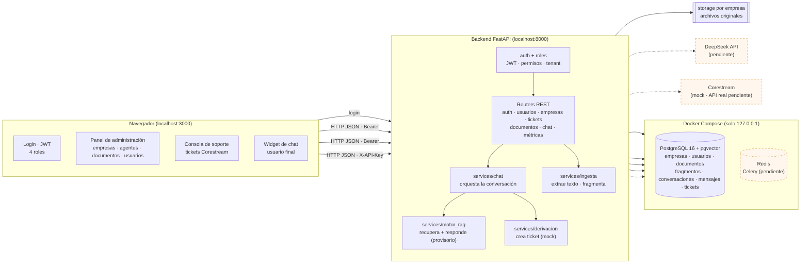
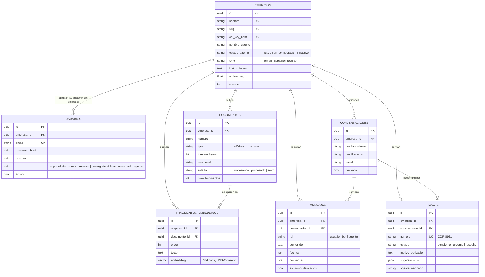
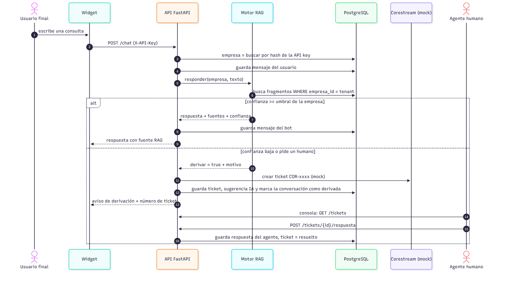

# Documentación técnica — Chatbot de Soporte Alloxentric

Capstone PTY4614 · Duoc UC · Fabián Armijo y Vicente Balladares · versión de la semana 9 (6 de octubre de 2026)

## 1. Qué es

Plataforma de soporte con IA, **multi-tenant**, que varias empresas del ecosistema Alloxentric (WellQ, Alloxentric,
Dani ETH, Dani27001, Aprueba) usan para atender a sus propios usuarios. Cada empresa carga su documentación; el
chatbot responde con RAG sobre *esa* documentación y, cuando no puede resolver, **deriva a un agente humano** creando
un ticket en Corestream. El sistema corre **100% en local** (sin nube).

## 2. Arquitectura



| Componente | Qué hace | Dónde está |
|---|---|---|
| Login y usuarios | Inicio de sesión (JWT), roles y gestión de usuarios | `LoginScreen.tsx`, `UsersView.tsx`, `auth/permissions.ts`, `backend/app/routers/auth.py` |
| Panel de administración | Alta de empresas, configuración del agente, carga de documentos, API key y widget | `frontend/src/components/AgentDeploymentPanel.tsx`, `AgentConfigModal.tsx`, `EmbedWidgetModal.tsx` |
| Consola de soporte | El agente humano ve los tickets derivados, la transcripción y una respuesta sugerida | `CorestreamConsole.tsx`, `TicketDetailModal.tsx` |
| Widget de chat | Lo que ve el usuario final | `WidgetPreview.tsx` (vista previa) |
| API REST | Expone todo por HTTP/JSON | `backend/app/routers/` |
| Servicios | Lógica de negocio separada de las rutas | `backend/app/services/` |
| PostgreSQL + pgvector | Guarda empresas, documentos, fragmentos con embeddings, conversaciones, mensajes y tickets | `docker-compose.yml`, `backend/app/models/` |
| Redis | Reservado para Celery (ingesta en segundo plano) | `docker-compose.yml` — **pendiente** |
| Carpeta `storage/` | Archivos originales subidos, una subcarpeta por empresa | `STORAGE_DIR` en `.env` |
| DeepSeek / Corestream | Modelo de lenguaje y ticketera | **pendientes** (hoy: motor provisorio y mock) |

El front **nunca** habla con la base de datos: todo pasa por la API.

## 3. Stack

| Capa | Tecnología |
|---|---|
| Backend | Python 3.11+, FastAPI, Uvicorn |
| Base de datos | PostgreSQL 16 + extensión pgvector (Docker) |
| ORM y migraciones | SQLAlchemy 2 + Alembic |
| Documentos | `pypdf` (PDF), `python-docx` (DOCX), texto plano (TXT, CSV, FAQ) |
| Frontend | React 19 + TypeScript + Vite + Tailwind (prototipo de Google AI Studio) |
| Pruebas | pytest (API contra Postgres real) y Playwright (navegador) |
| Orquestación local | Docker Compose |

## 4. Estructura del repositorio

```
proyecto/
├── docker-compose.yml        PostgreSQL+pgvector y Redis (puertos solo en 127.0.0.1)
├── .env.example
├── backend/
│   ├── app/
│   │   ├── main.py           app FastAPI + CORS
│   │   ├── config.py, db.py, deps.py, utils.py
│   │   ├── schemas.py        formas JSON (camelCase, iguales a los tipos del front)
│   │   ├── mappers.py        BD (español) -> JSON del front
│   │   ├── models/models.py  modelo de datos
│   │   ├── routers/          empresas · tickets · documentos · chat · metricas
│   │   └── services/         chat · motor_rag · ingesta · derivacion
│   ├── migrations/           Alembic (0001_modelo_inicial)
│   ├── tests/                pytest
│   ├── seed.py + seed_data.json
├── frontend/                 React (src/api/client.ts concentra las llamadas a la API)
├── tests_e2e/                prueba de navegador
└── docs/
```

## 5. Modelo de datos



Decisiones:

- **Multi-tenant por columna:** todas las tablas, salvo `empresas`, llevan `empresa_id` (con índice y `ON DELETE CASCADE`).
  `mensajes` y `tickets` lo repiten aunque se podría deducir de la conversación, para filtrar siempre por tenant sin joins.
- **Embeddings de 384 dimensiones** (modelo `paraphrase-multilingual-MiniLM-L12-v2`) con índice **HNSW** por distancia coseno.
- `empresas.slug` es el identificador público (`wellq`, `dani-eth`…); el `uuid` es interno. El front usa el `slug` como `id`.
- La API key de cada empresa se guarda **solo como hash SHA-256**; el texto plano se muestra una vez al generarla.
- `tickets.numero` (`COR-8921`) es único; el siguiente se calcula como el máximo + 1.
- `mensajes.creado_en` se asigna en Python (no con `now()` de Postgres): dentro de una misma transacción `now()` repite la hora
  y desordenaba la transcripción (bug encontrado en las pruebas).
- **Usuarios y roles:** `usuarios.rol` ∈ {`superadmin`, `admin_empresa`, `encargado_tickets`, `encargado_agente`}. `empresa_id` es nulo solo
  para el superadmin; dos `CHECK` en la BD lo garantizan. Las claves se guardan con PBKDF2-SHA256 + sal. Ver `MATRIZ_PERMISOS.md`.
- Los cambios de esquema se versionan con Alembic (`0001` modelo inicial con la extensión `vector`; `0002` roles de usuario).

## 6. Flujos principales

### 6.1 Conversación y derivación



1. El widget (un iframe a `/chat/{slug}`) envía `POST /publico/{slug}/chat`; la empresa se deduce del slug de la ruta (el cliente nunca manda `empresa_id`).
   Las integraciones propias pueden usar `POST /chat` con la API key de la empresa.
2. El motor busca fragmentos **solo de esa empresa** y calcula una confianza.
3. Si la confianza supera el **umbral de la empresa** (`umbral_rag`) responde con la fuente; si no, o si el usuario pide un humano,
   se crea el ticket, se guarda una sugerencia de respuesta y la conversación queda marcada como derivada.
4. Una vez derivada, los mensajes siguientes del usuario se guardan pero el bot ya no responde: responde el agente humano desde la consola.

### 6.2 Ingesta de documentos

`POST /empresas/{slug}/documentos` → valida tipo (pdf, docx, txt, faq, csv) y tamaño (máx. 20 MB) → guarda el archivo en
`storage/<empresa_id>/` → crea el documento en estado `procesando` → en segundo plano extrae el texto, lo divide en fragmentos de
~800 caracteres por párrafos y los guarda → estado `procesado` (o `error` si el archivo está corrupto). El panel consulta cada
1,5 s hasta que termina.

## 7. API

Documentación interactiva: `http://localhost:8000/docs` (botón *Authorize* para probar con un token). Todas las rutas, salvo `/health`,
`/auth/login`, `/chat` (API key) y `/publico/*` (chat público por slug), exigen `Authorization: Bearer <token>` y un rol permitido (ver `MATRIZ_PERMISOS.md`). Las respuestas usan camelCase y la misma forma que
`frontend/src/types/index.ts`.

| Método y ruta | Descripción |
|---|---|
| `POST /auth/login` · `GET /auth/me` | Iniciar sesión (devuelve JWT y usuario) / ver el usuario actual |
| `GET/POST /usuarios` · `PATCH/DELETE /usuarios/{id}` | Gestión de usuarios (superadmin: todos; admin de empresa: los suyos) |
| `GET /empresas` · `POST /empresas` | Listar (cada rol ve las suyas) / crear empresa (solo superadmin; devuelve la API key una vez) |
| `GET/PATCH /empresas/{slug}` | Ver / actualizar configuración del agente |
| `POST /empresas/{slug}/api-key` | Generar o rotar la API key |
| `GET/POST /empresas/{slug}/documentos` | Listar / subir documento (multipart, campo `archivo`) |
| `DELETE /documentos/{id}` · `GET /documentos/{id}/fragmentos` | Borrar / ver fragmentos |
| `GET /tickets?company_id=&status=` · `GET/PATCH /tickets/{id}` | Cola de la consola; cambiar estado o asignar agente |
| `POST /tickets/{id}/respuesta` | El agente responde; el ticket pasa a `resuelto` |
| `POST /chat` (header `X-API-Key`) | Integraciones propias (exige agente `activo`) |
| `GET /publico/{slug}` | Marca y estado del agente para pintar el chat público (sin documentos ni claves) |
| `POST /publico/{slug}/chat` | Chat público: página `/chat/{slug}` y widget embebible (exige agente `activo`) |
| `POST /empresas/{slug}/probar` | Simulador del panel (sin API key) |
| `GET /metricas` | Tickets abiertos/urgentes, conversaciones de hoy, tasa de resolución del bot |

Ejemplo:

```bash
curl -X POST http://localhost:8000/chat \
  -H "X-API-Key: ak_..." -H "Content-Type: application/json" \
  -d '{"message": "¿Cuánto tardan los reembolsos?", "customerName": "Ana"}'
```

## 8. Seguridad y aislamiento multi-tenant

- **RNF-01:** toda consulta a datos de una empresa filtra por `empresa_id`; el tenant sale de la API key (o del usuario autenticado), nunca del cuerpo de la petición.
  El chat público (`/publico/{slug}`) toma el tenant del slug de la ruta: solo responde con el agente `activo` y solo devuelve datos de marca.
  Una conversación de la empresa A no se puede continuar con la API key ni con el slug de B (devuelve 404).
- **RNF-02:** no hay credenciales en el código; todo va en `.env`, que está en `.gitignore`.
- **RNF-03:** PostgreSQL y Redis publican sus puertos solo en `127.0.0.1`.
- **RNF-04:** los documentos originales viven en `storage/`, excluida del repositorio; solo el backend la lee.
- Subidas: se valida extensión y tamaño y se sanitiza el nombre del archivo.
- **RF-28 / RF-30:** login con JWT y cuatro roles (superadmin, admin de empresa, encargado de tickets, encargado del agente IA), con
  autorización por rol y aislamiento por empresa en cada endpoint. Matriz completa en `MATRIZ_PERMISOS.md`.
- Configura `JWT_SECRET` en `.env` (largo y aleatorio) y cambia las claves del seed antes de usar el sistema fuera de tu notebook.

## 9. Ejecución local

Ver `README.md` en la raíz del proyecto (pasos con Docker Compose, Alembic, seed, Uvicorn y Vite).

## 10. Pruebas

| Tipo | Archivo | Qué cubre |
|---|---|---|
| API (pytest, Postgres real) | `backend/tests/test_api.py` (13) y `test_roles.py` (22) — 35 pruebas | **Login, matriz de permisos por rol, aislamiento entre empresas, gestión de usuarios y constraints de la BD**; CRUD de empresas y forma JSON, ingesta (TXT, PDF, DOCX, archivo corrupto), chat con RAG y derivación, **chat público por slug y su aislamiento**, flujo del agente, numeración de tickets, **aislamiento multi-tenant**, métricas, carga del seed |
| Navegador (Playwright) | `tests_e2e/test_flujos_navegador.py` — 31 verificaciones | **Login y permisos por rol (menús, tickets filtrados, crear usuario, cerrar sesión)**; consola → ticket → respuesta; subir documento; chat con respuesta RAG; derivación y ticket nuevo en la consola; crear empresa; **chat público `/chat/{slug}` y widget embebido en un sitio de otro origen** |
| Migración | manual | `alembic upgrade head`, `alembic check` (sin diferencias con los modelos) y `downgrade base` sobre un Postgres real |

Los tests de API usan una base temporal (o `TEST_DATABASE_URL`) porque vacían las tablas.

## 11. Trazabilidad con los requisitos

| Requisito | Dónde está | Estado |
|---|---|---|
| RF-01, RF-02 | `models/models.py`, `migrations/` | Hecho |
| RF-03 | `routers/empresas.py`, `routers/auth.py` (usuarios) | Hecho |
| RF-04, RF-05 | `routers/documentos.py`, `services/ingesta.py` (faltan embeddings) | En curso |
| RF-06 | `BackgroundTasks` (Celery pendiente) | En curso |
| RF-07, RF-08 | `services/motor_rag.py` (provisorio por palabras clave) | En curso |
| RF-09 | DeepSeek | Pendiente |
| RF-10, RF-11 | `WidgetPreview.tsx`, `routers/chat.py` | Hecho |
| RF-12, RF-13 | `services/derivacion.py` (mock con `CORESTREAM_MOCK`) | Hecho |
| RF-14, RF-15 | `CorestreamConsole.tsx`, `routers/tickets.py` (sugerencia IA provisoria) | Hecho / En curso |
| RF-16, RF-17 | `AgentDeploymentPanel.tsx`, `AgentConfigModal.tsx`, `EmbedWidgetModal.tsx` | Hecho / En curso |
| RF-18 a RF-23 | `docker-compose.yml`, `.env.example` | Pendiente de confirmar en ambas notebooks |
| RF-24 a RF-26 | `backend/tests/`, `tests_e2e/` | En curso |
| RF-27 | `docs/` | En curso |
| RF-28, RF-30 | `routers/auth.py`, `deps.py`, `security.py`, `LoginScreen.tsx`, `UsersView.tsx` | Hecho |
| RF-29 | `frontend/public/widget.min.js`, `PublicChat.tsx`, `routers/publico.py` | Hecho |

## 12. Pendientes y riesgos

| Pendiente | Responsable | Semana (replan) |
|---|---|---|
| Embeddings (sentence-transformers) y guardado en `fragmentos_embeddings` | Vicente | S9–S10 |
| Motor RAG real: búsqueda pgvector, DeepSeek, clasificador de intención | Vicente | S9–S12 |
| Widget embebible `widget.min.js` y página pública `/chat/{slug}` | Fabián | S9–S10 (hecho) |
| Integración real con Corestream (depende de su documentación) | Fabián | S11–S12 |
| Celery + Redis para la ingesta | Vicente | S10–S12 |
| Vista Analítica con datos reales (hoy usa datos de ejemplo) | Fabián | por definir |

**Riesgo principal:** la cadena embeddings → motor RAG → pruebas depende de una sola persona y tiene 4 semanas para el motor.
El contrato del motor (`responder` y `sugerir_respuesta` en `services/motor_rag.py`) ya está fijo, así que el front y la API no
cambian cuando se reemplace.
