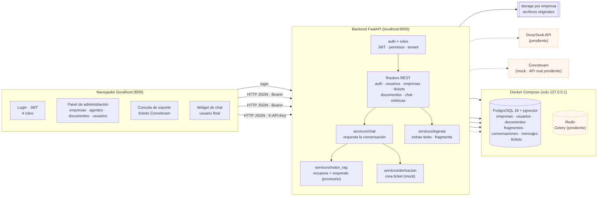
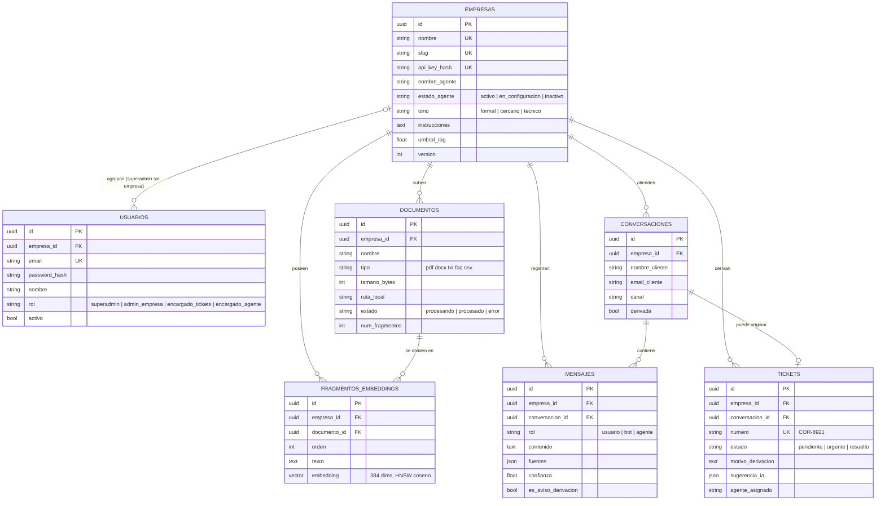
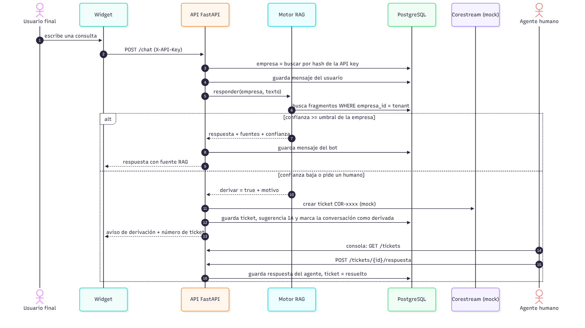

# Documentación técnica — Chatbot de Soporte Alloxentric

Capstone PTY4614 · Duoc UC · Fabián Armijo y Vicente Balladares · versión de la semana 9 (6 de octubre de 2026)

## 1. Qué es

Plataforma de soporte con IA, **multi-tenant**, que varias empresas del ecosistema Alloxentric (WellQ, Alloxentric,
Dani ETH, Dani27001, Aprueba) usan para atender a sus propios usuarios. Cada empresa carga su documentación; el
chatbot responde con RAG sobre *esa* documentación y, cuando no puede resolver, **deriva a un agente humano** creando
un ticket en Corestream. El sistema corre en local; el único servicio externo es **AWS Bedrock** (el LLM).

## 2. Arquitectura



| Componente | Qué hace | Dónde está |
|---|---|---|
| Login y usuarios | Inicio de sesión (JWT), roles y gestión de usuarios | `LoginScreen.tsx`, `UsersView.tsx`, `auth/permissions.ts`, `backend/app/routers/auth.py` |
| Panel de administración | Alta de empresas, configuración del agente, carga de documentos, API key y widget | `frontend/src/components/AgentDeploymentPanel.tsx`, `AgentConfigModal.tsx`, `EmbedWidgetModal.tsx` |
| Consola de soporte | El agente humano ve los tickets derivados, la transcripción y una respuesta sugerida | `CorestreamConsole.tsx`, `TicketDetailModal.tsx` |
| Widget de chat | Lo que ve el usuario final | `WidgetPreview.tsx` (vista previa) |
| API REST | Expone todo por HTTP/JSON | `backend/app/routers/` |
| Servicios | Lógica de negocio separada de las rutas | `backend/app/services/` |
| PostgreSQL + pgvector | Guarda empresas, documentos, fragmentos con embeddings, conversaciones, mensajes y tickets | `docker-compose.yml`, `backend/app/models/` |
| Redis | Reservado para Celery (ingesta en segundo plano) | `docker-compose.yml` — **pendiente** |
| Carpeta `storage/` | Archivos originales subidos, una subcarpeta por empresa | `STORAGE_DIR` en `.env` |
| AWS Bedrock / Corestream | Modelo de lenguaje y ticketera | Bedrock integrado vía API Converse (modo extractivo si está apagado); Corestream es un mock |

El front **nunca** habla con la base de datos: todo pasa por la API.

## 3. Stack

| Capa | Tecnología |
|---|---|
| Backend | Python 3.11+, FastAPI, Uvicorn |
| Base de datos | PostgreSQL 16 + extensión pgvector (Docker) |
| ORM y migraciones | SQLAlchemy 2 + Alembic |
| Documentos | `pypdf` (PDF), `python-docx` (DOCX), texto plano (TXT, CSV, FAQ) |
| Frontend | React 19 + TypeScript + Vite + Tailwind (prototipo de Google AI Studio) |
| Pruebas | pytest (API contra Postgres real) y Playwright (navegador) |
| Orquestación local | Docker Compose |

## 4. Estructura del repositorio

```
proyecto/
├── docker-compose.yml        PostgreSQL+pgvector y Redis (puertos solo en 127.0.0.1)
├── .env.example
├── backend/
│   ├── app/
│   │   ├── main.py           app FastAPI + CORS
│   │   ├── config.py, db.py, deps.py, utils.py
│   │   ├── schemas.py        formas JSON (camelCase, iguales a los tipos del front)
│   │   ├── mappers.py        BD (español) -> JSON del front
│   │   ├── models/models.py  modelo de datos
│   │   ├── routers/          empresas · tickets · documentos · chat · metricas
│   │   └── services/         chat · motor_rag · ingesta · derivacion
│   ├── migrations/           Alembic (0001_modelo_inicial)
│   ├── tests/                pytest
│   ├── seed.py + seed_data.json
├── frontend/                 React (src/api/client.ts concentra las llamadas a la API)
├── tests_e2e/                prueba de navegador
└── docs/
```

## 5. Modelo de datos



Decisiones:

- **Multi-tenant por columna:** todas las tablas, salvo `empresas`, llevan `empresa_id` (con índice y `ON DELETE CASCADE`).
  `mensajes` y `tickets` lo repiten aunque se podría deducir de la conversación, para filtrar siempre por tenant sin joins.
- **Embeddings de 384 dimensiones** (modelo `paraphrase-multilingual-MiniLM-L12-v2`) con índice **HNSW** por distancia coseno.
- `empresas.slug` es el identificador público (`wellq`, `dani-eth`…); el `uuid` es interno. El front usa el `slug` como `id`.
- La API key de cada empresa se guarda **solo como hash SHA-256**; el texto plano se muestra una vez al generarla.
- `tickets.numero` (`COR-8921`) es único; el siguiente se calcula como el máximo + 1.
- `mensajes.creado_en` se asigna en Python (no con `now()` de Postgres): dentro de una misma transacción `now()` repite la hora
  y desordenaba la transcripción (bug encontrado en las pruebas).
- **Usuarios y roles:** `usuarios.rol` ∈ {`superadmin`, `admin_empresa`, `encargado_tickets`, `encargado_agente`}. `empresa_id` es nulo solo
  para el superadmin; dos `CHECK` en la BD lo garantizan. Las claves se guardan con PBKDF2-SHA256 + sal. Ver `MATRIZ_PERMISOS.md`.
- Los cambios de esquema se versionan con Alembic (`0001` modelo inicial con la extensión `vector`; `0002` roles de usuario; `0003` el agente asignado a un ticket pasa de texto libre a un usuario; `0004` ciclo del ticket con encuesta de resolución; `0005` modelo del embedding por fragmento).

## 6. Flujos principales

### 6.1 Conversación y derivación



1. El widget (un iframe a `/chat/{slug}`) envía `POST /publico/{slug}/chat`; la empresa se deduce del slug de la ruta (el cliente nunca manda `empresa_id`).
   Las integraciones propias pueden usar `POST /chat` con la API key de la empresa.
2. El motor busca fragmentos **solo de esa empresa** y calcula una confianza.
3. Si la confianza supera el **umbral de la empresa** (`umbral_rag`) responde con la fuente; si no, o si el usuario pide un humano,
   se crea el ticket, se guarda una sugerencia de respuesta y la conversación queda marcada como derivada.
4. Una vez derivada, los mensajes siguientes del usuario se guardan pero el bot ya no responde: responde el agente humano desde la consola.
5. El cliente ve esa respuesta en el mismo chat: la página `/chat/{slug}` (y el iframe del widget) consulta `GET /publico/{slug}/conversaciones/{id}`
   cada 5 s mientras la pestaña está visible. El `conversationId` se guarda en el navegador para recuperar la conversación al recargar,
   y el widget cerrado muestra un punto rojo cuando llega una respuesta.

### Ciclo de vida del ticket y encuesta de resolución (definición de negocio)

El encargado **no cierra** los tickets: cuando responde, el cliente recibe una **encuesta** («¿se resolvió tu consulta?») y es el cliente quien decide.

| Desde | Evento | Hacia |
|---|---|---|
| `pendiente` / `urgente` (cola del encargado) | el encargado responde (se envía la encuesta) | `esperando_cliente` |
| `esperando_cliente` | el cliente responde **Sí** | `cerrado` (final: **no se reabre**) |
| `esperando_cliente` | el cliente responde **No** | `escalado` (se gestiona fuera del chat) |
| `esperando_cliente` | pasan 72 h (`ENCUESTA_HORAS`) sin respuesta | `cerrado` (motivo `sin_respuesta`) |
| `esperando_cliente` | el cliente escribe en vez de contestar | `pendiente` (vuelve a la cola) |
| `escalado` | el admin de la empresa o el superadmin lo cierra | `cerrado` (motivo `gestion_manual`) |

- **Cerrado:** ya nadie lo modifica ni responde; si el cliente vuelve a escribir en esa conversación recibe 409 y debe iniciar una nueva (ticket nuevo).
- **Escalado:** sale de la cola del encargado de tickets (no lo ve) y el chat deja de responder; solo lo ven y lo cierran `admin_empresa` y `superadmin`.
- Sin planificador (Celery pendiente), el cierre a las 72 h se aplica al leer tickets, métricas y conversaciones (`services/ciclo_ticket.py`).

### 6.2 Ingesta de documentos

`POST /empresas/{slug}/documentos` → valida tipo (pdf, docx, txt, faq, csv) y tamaño (máx. 20 MB) → guarda el archivo en
`storage/<empresa_id>/` → crea el documento en estado `procesando` → en segundo plano extrae el texto, lo divide en fragmentos de
~800 caracteres por párrafos y los guarda → estado `procesado` (o `error` si el archivo está corrupto). El panel consulta cada
1,5 s hasta que termina.

## 6.3 Motor RAG y embeddings

Implementado en `services/embeddings.py`, `services/motor_rag.py` y `services/llm.py`. **Estado:** validado con el modelo real de punta a punta (E2E 49/49) y
calibrado con la batería de calidad (`backend/calidad_rag/`). **Falta probar Bedrock en vivo** (aún no hay perfil de AWS configurado: hoy responde en modo extractivo).

**Embeddings (RF-04).** `EMBEDDINGS_BACKEND=sentence-transformers` (por defecto) usa `paraphrase-multilingual-MiniLM-L12-v2`, local, 384
dimensiones; la primera vez descarga el modelo (~470 MB) a la caché de Hugging Face y luego funciona sin conexión. `EMBEDDINGS_BACKEND=hash`
es un embedder por palabras sin descargas (pruebas, CI y respaldo si el modelo no carga: se avisa en el log y en `/health`).
Cada fragmento guarda el **id del embedder** que lo generó (`fragmentos_embeddings.modelo`) y la búsqueda solo usa los del embedder activo;
tras cambiar de modelo se regeneran con `python reindexar.py`.

**Fragmentación (RF-05).** Un fragmento por párrafo (los muy cortos se unen al siguiente; los de más de 700 caracteres se cortan por oraciones).
Juntar párrafos diluye la similitud y baja la confianza.

**Flujo de `responder`:**
1. *Intención* (reglas, sin LLM): pide un humano → deriva; saludo / gracias / despedida → respuesta fija sin derivar ni crear ticket; el resto es consulta.
2. *Recuperación:* embedding de la pregunta y búsqueda por coseno **solo en fragmentos de la empresa**, de documentos `procesado` y del embedder activo (top-4).
3. *Decisión:* la mejor similitud se convierte en **confianza 0..1** (rango `sim_min..sim_max` de cada embedder) y se compara con el `umbral_rag` de la empresa.
   Bajo el umbral → se deriva a un humano y se crea el ticket.
4. *Generación:* con `BEDROCK_HABILITADO=true` (perfil `AWS_PROFILE`, modelo `BEDROCK_MODEL_ID`), Bedrock redacta la respuesta usando **solo los fragmentos de esa empresa**, con su tono e instrucciones;
   si contesta `NO_SE`, se deriva. Sin clave, o ante cualquier falla de red/API, responde de forma extractiva con el fragmento más relevante (el chat no se cae).
5. *Sugerencia para el agente humano* (`sugerir_respuesta`): borrador generado con los mismos fragmentos (o plantilla si no hay clave).

**Dónde se calcula la similitud (`RAG_SEARCH`).** `pgvector` (por defecto) usa la distancia coseno en la BD con el índice HNSW. `python` hace la búsqueda
exacta en el backend: existe porque el pgvector que trae el Postgres sin Docker (`pixeltable-pgserver`) se **cae al calcular distancias** en CPUs sin
AVX-512; con el Docker oficial `pgvector/pgvector` funciona. En ese Postgres temporal las pruebas eliminan el índice HNSW (solo en la BD de pruebas).
Con `TEST_DATABASE_URL` apuntando a un Postgres real las pruebas usan `pgvector`.

**Calidad medida** (`python calidad_rag/evaluar.py`, 45 preguntas sobre un corpus de 4 documentos / 15 fragmentos: 25 con respaldo y 20 sin él,
redactadas con otras palabras que el texto; incluye fuera de tema, temas del rubro no documentados, inyección de instrucciones y texto sin sentido):

| Métrica | `hash` (léxico) | `paraphrase-multilingual-MiniLM-L12-v2` |
|---|---|---|
| Fuente correcta en el top-1 / top-3 | 72 % / 100 % | **96 % / 100 %** |
| Separación con vs. sin respaldo (AUC) | 0.80 | **0.93** |
| Exactitud global al umbral 0.8 | 64 % | **80 %** |

Con el modelo real y el umbral por defecto (0.8): responde bien 18 de 25 preguntas con respaldo (72 %), deriva 18 de 20 sin respaldo y
**responde sin respaldo 2 de 20** ("¿Tienen urgencia 24 horas con ambulancia?" y un intento de inyección). Lo que cambia la empresa con su `umbral_rag`:

| Umbral | Responde bien (con respaldo) | Responde mal (sin respaldo) | Deriva de más |
|---|---|---|---|
| 0.5 | 84 % | 25 % | 4 |
| 0.6 | 84 % | 20 % | 4 |
| 0.7 | 80 % | 15 % | 5 |
| **0.8** | **72 %** | **10 %** | 7 |
| 0.9 | 60 % | 5 % | 10 |

Subir el umbral reduce las respuestas sin respaldo a costa de derivar más. Con Bedrock activo hay una segunda barrera (`NO_SE`), por lo que
conviene un umbral algo más bajo; **sin clave** (modo extractivo) un falso positivo muestra un fragmento irrelevante, y es preferible 0.85–0.9.
La rúbrica es un corpus pequeño y de un solo rubro: sirve para comparar embedders y vigilar regresiones, no como cifra definitiva en producción.

**Límites conocidos:** la confianza depende de la calibración de `sim_min/sim_max` (`SentenceTransformerEmbedder`: 0.25–0.51); el filtro por empresa
con el índice HNSW puede devolver menos de k resultados si una empresa tiene pocos fragmentos entre muchos de otras (en este tamaño no es un problema);
los documentos subidos antes de este cambio se vuelven a procesar o se reindexan.

## 7. API

Documentación interactiva: `http://localhost:8000/docs` (botón *Authorize* para probar con un token). Todas las rutas, salvo `/health`,
`/auth/login`, `/chat` (API key) y `/publico/*` (chat público por slug), exigen `Authorization: Bearer <token>` y un rol permitido (ver `MATRIZ_PERMISOS.md`). Las respuestas usan camelCase y la misma forma que
`frontend/src/types/index.ts`.

| Método y ruta | Descripción |
|---|---|
| `POST /auth/login` · `GET /auth/me` | Iniciar sesión (devuelve JWT y usuario) / ver el usuario actual |
| `GET/POST /usuarios` · `PATCH/DELETE /usuarios/{id}` | Gestión de usuarios (superadmin: todos; admin de empresa: los suyos) |
| `GET /empresas` · `POST /empresas` | Listar (cada rol ve las suyas) / crear empresa (solo superadmin; devuelve la API key una vez) |
| `GET/PATCH /empresas/{slug}` | Ver / actualizar configuración del agente (incluye `aiModel`, validado contra el catálogo) |
| `GET /modelos-ia` | Catálogo de modelos de IA que se pueden elegir (superadmin, admin de empresa y encargado del agente) |
| `POST /empresas/{slug}/api-key` | Generar o rotar la API key |
| `GET/POST /empresas/{slug}/documentos` | Listar / subir documento (multipart, campo `archivo`) |
| `DELETE /documentos/{id}` · `GET /documentos/{id}/fragmentos` | Borrar / ver fragmentos |
| `GET /tickets?company_id=&status=` · `GET/PATCH /tickets/{id}` | Cola de la consola; cambiar estado o asignar agente |
| `POST /tickets/{id}/respuesta` | El agente responde y envía la encuesta; el ticket pasa a `esperando_cliente` (409 si está `cerrado` o `escalado`) |
| `POST /chat` (header `X-API-Key`) | Integraciones propias (exige agente `activo`) |
| `GET /publico/{slug}` | Marca y estado del agente para pintar el chat público (sin documentos ni claves) |
| `POST /publico/{slug}/chat` | Chat público: página `/chat/{slug}` y widget embebible (exige agente `activo`) |
| `GET /publico/{slug}/conversaciones/{id}` | Transcripción y estado del ticket de una conversación (el cliente ve la respuesta del agente); 404 si no es de esa empresa |
| `POST /publico/{slug}/conversaciones/{id}/encuesta` | El cliente responde la encuesta (`{"resolved": true/false}`); solo válido con el ticket `esperando_cliente` (409 si no) |
| `POST /empresas/{slug}/probar` | Simulador del panel (sin API key) |
| `GET /metricas` | Tickets abiertos/urgentes, conversaciones de hoy, tasa de resolución del bot |
| `GET /metricas/analitica?dias=7\|14\|30` | Vista Analítica: totales, volumen diario y comparativa por empresa (cada rol ve solo lo suyo) |
| `GET /tickets/agentes` | Usuarios activos (admin o encargado de tickets) a los que se puede asignar un ticket de la empresa |

Ejemplo:

```bash
curl -X POST http://localhost:8000/chat \
  -H "X-API-Key: ak_..." -H "Content-Type: application/json" \
  -d '{"message": "¿Cuánto tardan los reembolsos?", "customerName": "Ana"}'
```

## 8. Seguridad y aislamiento multi-tenant

- **RNF-01:** toda consulta a datos de una empresa filtra por `empresa_id`; el tenant sale de la API key (o del usuario autenticado), nunca del cuerpo de la petición.
  El chat público (`/publico/{slug}`) toma el tenant del slug de la ruta: solo responde con el agente `activo` y solo devuelve datos de marca.
  Una conversación de la empresa A no se puede continuar con la API key ni con el slug de B (devuelve 404).
- **RNF-02:** no hay credenciales en el código; todo va en `.env`, que está en `.gitignore`.
- **RNF-03:** PostgreSQL y Redis publican sus puertos solo en `127.0.0.1`.
- **RNF-04:** los documentos originales viven en `storage/`, excluida del repositorio; solo el backend la lee.
- **Límite de peticiones (rate limiting):** los endpoints sin sesión se limitan por IP (ventana deslizante en memoria, `app/ratelimit.py`).
  Superado el límite responden **429** con `Retry-After`.

  | Endpoint | Límite (por minuto) |
  |---|---|
  | `POST /publico/{slug}/chat` | 20 mensajes por IP y empresa; **6 conversaciones nuevas** (cada derivación crea un ticket) |
  | `GET /publico/{slug}/conversaciones/{id}` | 30 (el widget consulta 12 por minuto) |
  | `POST /publico/{slug}/conversaciones/{id}/encuesta` | 10 |
  | `GET /publico/{slug}` | 60 |
  | `POST /chat` (API key) | 120 |
  | `POST /auth/login` | 8 por IP y correo (fuerza bruta) y 30 por IP |

  Es **por proceso**: con un solo uvicorn local basta; si se despliega con varios workers hay que mover los contadores a Redis. Se desactiva con
  `RATE_LIMIT_ENABLED=false`; tras un proxy de confianza, `TRUST_PROXY_HEADERS=true` usa `X-Forwarded-For`.
- Subidas: se valida extensión y tamaño y se sanitiza el nombre del archivo.
- **RF-28 / RF-30:** login con JWT y cuatro roles (superadmin, admin de empresa, encargado de tickets, encargado del agente IA), con
  autorización por rol y aislamiento por empresa en cada endpoint. Matriz completa en `MATRIZ_PERMISOS.md`.
- Configura `JWT_SECRET` en `.env` (largo y aleatorio) y cambia las claves del seed antes de usar el sistema fuera de tu notebook.

## 9. Ejecución local

Ver `README.md` en la raíz del proyecto. En Windows, `.\iniciar.ps1` hace todo (`-SinDocker` usa un Postgres embebido; `.\detener.ps1` apaga).

**Credenciales de desarrollo**

| Rol | Correo | Clave | Qué ve y qué puede probar |
|---|---|---|---|
| **Superadmin** | `superadmin@alloxentric.local` | la de `SUPERADMIN_PASSWORD` en tu `.env` (`iniciar.ps1` la genera al azar; si corres `seed.py` sin esa variable es `Superadmin123!`) | Todo: todas las empresas, tickets y usuarios; crea empresas y otros superadmins |
| **Admin de empresa** | `admin@<slug>.demo` | `Demo1234!` | Consola, agentes, analítica y usuarios de **su** empresa; ve y cierra los tickets escalados |
| **Encargado de tickets** | `tickets@<slug>.demo` | `Demo1234!` | Solo Consola de soporte y Analítica de su empresa (no ve los tickets escalados) |
| **Encargado del agente IA** | `agente@<slug>.demo` | `Demo1234!` | Empresas y agentes, documentos y vista previa del widget de su empresa; sin consola ni usuarios |

`<slug>` es uno de: `wellq`, `alloxentric`, `dani-eth`, `dani27001`, `aprueba` (15 usuarios demo: 3 por empresa). Son claves **solo de desarrollo**:
cámbialas antes de usar el sistema fuera de tu notebook. Para crear un superadmin en una BD ya poblada: `python crear_superadmin.py correo@dominio.cl`.


## 10. Pruebas

| Tipo | Archivo | Qué cubre |
|---|---|---|
| API (pytest, Postgres real) | `backend/tests/test_api.py` (15), `test_roles.py` (28), `test_ciclo_ticket.py` (9), `test_ratelimit.py` (7) y `test_rag.py` (31) — 90 pruebas | **Login, matriz de permisos por rol, aislamiento entre empresas, gestión de usuarios y constraints de la BD**; CRUD de empresas y forma JSON, ingesta (TXT, PDF, DOCX, archivo corrupto), chat con RAG y derivación, **chat público por slug y su aislamiento**, flujo del agente, **asignación solo a usuarios de la empresa, remitente autenticado, campos de empresa por rol, analítica por empresa**, numeración de tickets, **aislamiento multi-tenant**, métricas, carga del seed |
| Navegador (Playwright) | `tests_e2e/test_flujos_navegador.py` — 49 verificaciones | **Login y permisos por rol (menús, tickets filtrados, crear usuario, cerrar sesión)**; consola → ticket → respuesta; subir documento; chat con respuesta RAG; derivación y ticket nuevo en la consola; crear empresa; **chat público `/chat/{slug}` y widget embebido en un sitio de otro origen; analítica real por rol, asignación a usuarios reales y remitente de la respuesta; el cliente ve la respuesta del agente (sin recargar y tras recargar) y el widget cerrado avisa** |
| Migración | manual | `alembic upgrade head`, `alembic check` (sin diferencias con los modelos) y `downgrade base` sobre un Postgres real |

Los tests de API usan una base temporal (o `TEST_DATABASE_URL`) porque vacían las tablas.

## 11. Trazabilidad con los requisitos

| Requisito | Dónde está | Estado |
|---|---|---|
| RF-01, RF-02 | `models/models.py`, `migrations/` | Hecho |
| RF-03 | `routers/empresas.py`, `routers/auth.py` (usuarios) | Hecho |
| RF-04, RF-05 | `routers/documentos.py`, `services/ingesta.py`, `services/embeddings.py` | Hecho (validado con el modelo real) |
| RF-06 | `BackgroundTasks` (Celery pendiente) | En curso |
| RF-07, RF-08 | `services/motor_rag.py` (búsqueda vectorial por empresa + umbral) | Hecho (calibrado con la batería de calidad) |
| RF-09 | `services/llm.py` (AWS Bedrock, con respaldo extractivo) | En curso (implementado; falta probar en vivo) |
| RF-10, RF-11 | `WidgetPreview.tsx`, `routers/chat.py` | Hecho |
| RF-12, RF-13 | `services/derivacion.py` (mock con `CORESTREAM_MOCK`) | Hecho |
| RF-14, RF-15 | `CorestreamConsole.tsx`, `routers/tickets.py` (sugerencia generada por el motor RAG) | Hecho |
| RF-16, RF-17 | `AgentDeploymentPanel.tsx`, `AgentConfigModal.tsx`, `EmbedWidgetModal.tsx` | Hecho |
| RF-18, RF-20 | `docker-compose.yml`, `.env.example`, `iniciar.ps1` | En curso (validado en una notebook sin Docker; falta Docker y la de Vicente) |
| RF-19, RF-21, RF-23 | `.env.example`, `.gitignore`, `docker-compose.yml` | Hecho |
| RF-22 | `docker-compose.yml` (Redis) | Pendiente (hasta implementar Celery) |
| RF-24 a RF-26, RF-37 | `backend/tests/`, `tests_e2e/`, `backend/calidad_rag/` | Hecho |
| RF-27 | `docs/` | En curso |
| RF-31 | `routers/publico.py`, `PublicChat.tsx`, `widget.min.js` | Hecho |
| RF-32 | `services/ciclo_ticket.py`, `routers/tickets.py`, `routers/publico.py`, migración 0004 | Hecho |
| RF-33 | `routers/tickets.py` (`/tickets/agentes`), migración 0003 | Hecho |
| RF-34 | `routers/metricas.py`, `AnalyticsView.tsx` | Hecho |
| RF-35 | `ratelimit.py` | Hecho |
| RF-36 | `iniciar.ps1`, `detener.ps1` | Hecho |
| RF-38 | `services/derivacion.py` | Pendiente (Corestream real) |
| RF-39 | `services/ciclo_ticket.py` | Pendiente (tarea periódica con Celery) |
| RF-28, RF-30 | `routers/auth.py`, `deps.py`, `security.py`, `LoginScreen.tsx`, `UsersView.tsx` | Hecho |
| RF-29 | `frontend/public/widget.min.js`, `PublicChat.tsx`, `routers/publico.py` | Hecho |

## 12. Pendientes y riesgos

| Pendiente | Responsable | Semana (replan) |
|---|---|---|
| Embeddings (sentence-transformers) y guardado en `fragmentos_embeddings` | Vicente | S9–S10 (hecho y validado con el modelo real) |
| Motor RAG real: búsqueda pgvector, Bedrock, clasificador de intención | Vicente | S9–S12 (hecho y calibrado; falta Bedrock en vivo) |
| Widget embebible `widget.min.js` y página pública `/chat/{slug}` | Fabián | S9–S10 (hecho) |
| Integración real con Corestream (depende de su documentación) | Fabián | S11–S12 |
| Celery + Redis para la ingesta | Vicente | S10–S12 |
| Vista Analítica con datos reales | Fabián | hecho (`GET /metricas/analitica`) |
| Mover los contadores del rate limiting a Redis (hoy en memoria, por proceso) si se despliega con varios workers | Fabián | solo si se escala |
| Cierre a las 72 h con un planificador real (hoy se aplica al leer; con Celery pasa a tarea periódica) | Vicente / Fabián | con Celery |

**Riesgos (semana 10):** (1) Bedrock en vivo depende de una cuenta de AWS con el modelo habilitado que aún no está configurada y es el único componente del RAG sin probar con datos reales;
(2) la integración real con Corestream depende de documentación y credenciales externas (hoy mock); (3) el motor RAG y los embeddings se
implementaron desde el repositorio de Fabián y requieren revisión de Vicente; (4) margen corto para el cierre: informe final y entregables académicos.
El resto de la lista de pendientes está en la hoja "Pendientes S10" del Excel de Requerimientos.


## Modelo de IA por empresa

Cada empresa elige el modelo que redacta las respuestas de su agente (`empresas.modelo_ia`, migración 0006; por defecto `haiku-5-5`).
El catálogo vive en `app/services/modelos.py` y todos los modelos se invocan por **AWS Bedrock** (API Converse), así que el único
servicio externo sigue siendo Bedrock. El id de Bedrock no sale del backend: la API expone solo el id público, el nombre, el proveedor y
la descripción (`GET /modelos-ia`). `motor_rag` toma el modelo de la empresa dentro de `responder` y `sugerir_respuesta` (las firmas no cambian).

| Id | Modelo | Proveedor | Id de Bedrock (us-east-1) |
|---|---|---|---|
| `haiku-5-5` | Claude Haiku 5.5 (recomendado) | Anthropic | `us.anthropic.claude-haiku-5-5` |
| `gpt-oss-20b` | GPT-OSS 20B | OpenAI | `openai.gpt-oss-20b-1:0` |
| `nova-lite` | Nova Lite | Amazon | `us.amazon.nova-lite-v1:0` |
| `deepseek-v3-2` | DeepSeek V3.2 | DeepSeek | `deepseek.v3.2` |
| `qwen3-32b` | Qwen3 32B | Qwen (Alibaba) | `qwen.qwen3-32b-v1:0` |

Los cinco se probaron en vivo (una pregunta con respuesta y otra sin ella, que debe contestar `NO_SE`). Para agregar un modelo: una línea en
`CATALOGO`, el logo en `frontend/src/assets/providers/` y su clave en `ProviderLogo.tsx`. Los modelos que razonan (`razona=True`) reciben
el triple de tokens de salida. Los logos son archivos locales (no se cargan desde internet).


## FinOps: consumo de IA y plan de gasto

**Qué se mide.** Cada llamada al modelo (la respuesta del bot y el borrador para el agente humano) guarda una fila en `usos_ia`
(migración 0007): empresa, conversación, modelo, tipo, tokens de entrada y salida (los informa Bedrock en `usage`) y el costo en USD.
El costo se calcula al momento con los precios de `services/modelos.py` (USD por millón de tokens, **referenciales**: confirmarlos con la
tabla de precios de Bedrock antes de cobrar) y queda guardado, así que un cambio de precios no reescribe el historial.
`llm.capturando()` junta los tokens de la petición y `services/chat.py` los guarda junto con la conversación.

**Plan de gasto** (`empresas.plan_gasto` y `limite_mensual_usd`; lo define solo el superadmin con `PATCH /empresas/{slug}/plan`):

| Plan | Comportamiento |
|---|---|
| `sin_limite` (por defecto) | Nunca se corta. Se cobra lo consumido en el mes. |
| `limitado` | Tope mensual en USD (mínimo 0,01). Al 80 % el panel avisa. Al llegar al 100 % el agente **deja de llamar al modelo y responde en modo extractivo** (con el fragmento más relevante); el chat no se cae. El mes siguiente se reinicia solo. |

El mes se calcula en la zona horaria local (`APP_TZ`). **Falta** el cobro automático al medio de pago del cliente: hoy el sistema mide y aplica el límite, no cobra.

**API** (todo filtrado por empresa): `GET /empresas/{slug}/finops` (superadmin y admin de la empresa) devuelve gasto, tokens, llamadas,
costo por conversación, desglose por modelo y una serie para el gráfico. Filtros: `desde` y `hasta` (AAAA-MM-DD, juntos; sin ellos, el mes en curso hasta hoy; máximo 366 días),
`modelo` (id del catálogo; acota totales y gráfico, no la tabla por modelo) y `agrupar=dia|semana|mes` (semanas de lunes a domingo, recortadas al rango). El bloque `billing`
es siempre el **mes en curso completo y todos los modelos**: es lo que mide el límite del plan, sin importar el filtro. En el panel la vista se llama «Consumo y costos». `PATCH /empresas/{slug}/plan` (solo superadmin).

## Registro de conversaciones

`GET /empresas/{slug}/conversaciones` lista **todas** las conversaciones del chatbot, tengan ticket o no (la más reciente primero), con filtros por
texto (cliente, correo, ticket o contenido de los mensajes), `ticket=con|sin`, canal y rango de fechas, y paginación. `GET /conversaciones/{id}` entrega
la transcripción completa, el ticket asociado y los tokens y el costo de IA de esa conversación. Lo ven superadmin, admin de empresa y encargado del
agente (el encargado de tickets sigue viendo solo los tickets). Incluye las conversaciones del simulador del panel.


## Pruebas del agente (golden sets)

**Para qué.** Ingestar documentos cambia lo que el agente recupera y responde. Un *golden set* es una lista de preguntas con la respuesta esperada; se
ejecuta contra el agente real y mide cómo le va. Cada corrida guarda con qué modelo, umbral RAG y base de conocimiento se hizo (nº de documentos y
fragmentos), así se compara con la corrida anterior del mismo conjunto y se ve si un documento nuevo mejoró o empeoró el desempeño.

**Conjuntos y casos** (tablas `conjuntos_prueba`, `casos_prueba`; migración 0008). Se crean a mano o con IA (`POST .../testing/conjuntos/generar`): el modelo
lee fragmentos de la documentación y propone preguntas con su respuesta esperada y su documento, más preguntas fuera de la documentación que *deben derivar*.
El modelo que genera los casos se **elige** (`modelId`, cualquiera del catálogo; por defecto Haiku 5.5) y queda guardado en el conjunto (`generado_con`). Los casos de IA quedan marcados `ia` para revisarlos; se descartan duplicados y documentos inventados. Un caso tiene: pregunta, respuesta esperada (opcional),
documento esperado (opcional) y «debe derivar a un humano».

**Corridas** (`ejecuciones_prueba`, `resultados_prueba`). `POST .../conjuntos/{id}/ejecutar` responde 202 y corre en segundo plano (`BackgroundTasks`, como la ingesta);
el panel consulta el avance. Una a la vez por empresa; una corrida «ejecutando» de más de 20 min se marca como interrumpida. Llama directo a `motor_rag.responder`: **no crea
conversaciones ni tickets**. Sí gasta tokens: el agente se registra en `usos_ia` como `prueba` y el evaluador como `juez`, y cuentan para el plan de gasto (si el tope mensual
se alcanza, el agente responde en modo extractivo y la corrida lo avisa).

**Evaluación de cada caso** (`services/evaluacion.py`): *derivación* (si esperaba derivar, derivó; si esperaba responder, no derivó), *fuente* (citó el documento esperado) y
*respuesta* (puntaje 0 a 1 de un **LLM as a Judge** contra la respuesta esperada). El juez se elige al ejecutar (`judgeModelId`, cualquiera del catálogo; por defecto Haiku 5.5) y queda guardado en la corrida (`modelo_juez`), en el CSV y en la pantalla; su gasto se registra a nombre de ese modelo. El juez recibe un criterio fijo (1 = dice lo mismo, 0,5 = parcial, 0 = incorrecta o inventa) y responde JSON con puntaje y motivo. Si el juez no responde o no devuelve un puntaje válido se usa la cobertura de palabras clave y el motivo del caso lo dice. Si el juez es el mismo modelo que el agente, la pantalla advierte del sesgo de autoevaluación. Probados en vivo como juez (correcta / parcial / incorrecta): Haiku 5.5, GPT-OSS 20B, Nova Lite y DeepSeek V3.2 puntúan 1 / 0,5 / 0; Qwen3 32B es más estricto (1 / 0 / 0). Aprobado = derivación correcta y fuente correcta
y puntaje ≥ 0,7. Métricas de la corrida: tasa de aprobación, puntaje promedio, precisión de fuentes y de derivación, confianza RAG, latencia promedio y p95, tokens y costo (agente y evaluador),
con la variación frente a la corrida anterior y los casos que regresaron o mejoraron.

**Exportación** (`GET .../ejecuciones/{id}/exportar?formato=csv|excel`, `services/reporte.py`). CSV UTF-8 con BOM y la plantilla de alloxentric: cabecera de marca, datos de la corrida,
bloque RESUMEN (métrica, valor, corrida anterior, variación) y bloque RESULTADOS con una fila por caso (pregunta, esperado, respuesta del agente, fuentes, confianza, puntaje, veredicto,
latencia, tokens, costo, motivo y veredicto anterior). `excel` separa con «;» (Excel en español). Las celdas que empiezan con `= + - @` se neutralizan para evitar inyección de fórmulas.

## Base de conocimiento (vista)

Solo lectura: `GET /empresas/{slug}/kb/resumen` (documentos por estado y tipo, fragmentos, caracteres, vectores y embedders, última subida) y
`GET /empresas/{slug}/kb/fragmentos` (los fragmentos con su documento; filtros `q`, `documento_id`, paginación). Subir y borrar documentos sigue en Empresas y agentes.


## Ciclo de calidad (S10)

**Alertas de gasto y tope diario.** Además del límite mensual, un plan limitado puede tener un **tope diario** (`empresas.limite_diario_usd`, no puede superar al mensual).
Al alcanzar cualquiera de los dos el agente deja de usar IA (modo extractivo). `finops.registrar` revisa los umbrales tras cada gasto y crea **notificaciones** (tabla `notificaciones`, una por clave:
`gasto-AAAA-MM-80`, `-100`, `gasto-dia-AAAA-MM-DD`): se ven en la campana y, si hay `SMTP_HOST`, se mandan también por correo a los admin de la empresa (best-effort; un correo caído nunca frena el chat).
Las alertas de gasto solo las ven superadmin y admin de empresa. `GET /empresas/{slug}/notificaciones`, `POST .../{id}/visto`, `POST .../visto-todas`.

**Pruebas automáticas.** Un golden set marcado `autoRun` corre solo al terminar de **subir, reemplazar o eliminar** un documento (`ingesta.procesar_documento` y `DELETE /documentos/{id}` llaman a
`evaluacion.disparar_automaticas`, en segundo plano). La corrida guarda `origen=automatica` y qué la disparó. Si empeoró frente a la corrida anterior del mismo modelo (cayó 5 puntos o más, o algún caso que
pasaba ahora falla) deja el aviso «Las pruebas … bajaron de 92 % a 78 %»; si mejoró 5 puntos o más, avisa que subieron. Solo corre una corrida por empresa a la vez: si hay otra, espera hasta ~2 min.

**Conversación real a caso.** `POST .../testing/conjuntos/{id}/casos` acepta `conversationId` (debe ser de la empresa): el caso queda con origen `real`. En el registro de conversaciones, el botón
«Agregar al golden set» propone la primera pregunta del cliente y, si la hubo, la respuesta del agente humano como respuesta esperada.

**Comparar modelos.** `POST .../conjuntos/{id}/comparar {modelIds (2 a 5), judgeModelId}` corre el mismo golden set con cada modelo (uno tras otro, mismo juez) sin tocar el modelo configurado
(`modelos.forzando`). `GET .../comparativas/{grupo}?calidad_minima=80` devuelve las corridas y recomienda **el más barato que cumple la calidad mínima**. Cada corrida se compara solo con corridas anteriores del
mismo modelo de agente.

**Calibrar al juez.** Una persona marca respuestas como correcta/incorrecta (`PUT .../resultados/{id}/etiqueta`). Con al menos 10 etiquetas (se usan hasta 40) `POST .../calibraciones {judgeModelIds}` hace
que cada juez vuelva a puntuar esas respuestas y mide el **acuerdo**, los falsos aprobados y rechazos y el **kappa de Cohen** (acuerdo corregido por azar: > 0,6 = confiable). Gasta tokens (tipo `juez`).

**Memoria de conversación.** `motor_rag.responder(..., historial=None)` recibe los últimos turnos (`services/chat.py` pasa hasta 6). Si el mensaje solo se entiende con lo anterior (muy corto o empieza
con «y si…», «eso…») se reescribe como una pregunta autónoma con una llamada corta al LLM (sin LLM o con el tope alcanzado, anteponiendo la última pregunta del cliente) y esa consulta se usa para buscar;
el LLM además ve el contexto. Sin historial se comporta igual que antes. La firma agrega un parámetro opcional al final: no rompe a quien la usa.

**Versiones de documentos.** `POST /documentos/{id}/reemplazar` sube un archivo nuevo conservando el anterior (`documento_versiones`, el archivo sigue en `storage/`); `GET .../versiones` lista el historial y
`POST .../versiones/{n}/restaurar` vuelve a una versión (queda como la más nueva). Reemplazar y restaurar reprocesan el documento y disparan las pruebas automáticas.

**Salud de la base.** `GET /empresas/{slug}/kb/calidad` revisa: documentos sin contenido, atascados en «procesando», fragmentos sin vector o de otro embedder (se ignoran al buscar), contenido repetido,
documentos casi idénticos (≥ 80 % de fragmentos en común) y fragmentos muy cortos; devuelve un puntaje de 0 a 100.

**Sitios autorizados del widget.** `empresas.dominios_permitidos` (vacío = cualquier sitio; `midominio.cl` o `*.midominio.cl`). El widget manda el sitio que lo incrusta en `X-Embed-Host`; los endpoints públicos y
`POST /chat` rechazan con 403 los sitios no autorizados. **Límite honesto:** evita que copien el snippet en otro sitio, pero no frena a quien llame la API a mano (para eso están el límite de peticiones y el tope de gasto);
una barrera real exigiría `frame-ancestors` en el servidor web que sirve el front.

**Celery + Redis.** Con `INGESTA_BACKEND=celery` la ingesta va a una tarea de Celery (`app/tasks.py`) y existe una tarea periódica que cierra los tickets con encuesta vencida cada 15 min en todas las empresas
(RF-39); si Redis no responde se cae a `BackgroundTasks`. Worker: `celery -A app.celery_app worker -l info -P solo` (Windows) y programador: `celery -A app.celery_app beat -l info`. Por defecto sigue `background`.
**No está validado contra un Redis real** (no hay Docker en el entorno de desarrollo): las pruebas usan el modo `task_always_eager`.


## Registro en autoservicio (cuenta → empresa → chatbot)

Flujo: `/registro` (o «Crear cuenta» en la landing) → **1. cuenta** (`POST /registro/usuario`, sin sesión) → **2. empresa** (`POST /registro/empresa`) → entra al panel y **3. crea su chatbot** (`POST /empresas/{slug}/chatbot`) eligiendo su **plan de gasto** (ilimitado o con límite mensual y tope diario opcional) → sube su documentación y publica el agente.

- **Rol `registrado`:** cuenta sin empresa (`empresa_id` NULL; la constraint pasó a `rol IN ('superadmin','registrado') = (empresa_id IS NULL)`, migración 0012). Solo puede `GET /auth/me` y `POST /registro/empresa`; el resto de los endpoints responde 403. Al registrar la empresa pasa a `admin_empresa` (el rol se lee de la BD, el mismo token sigue valiendo). Nadie puede asignarlo ni convertirlo en otro rol por `/usuarios`.
- **Un chatbot por empresa:** `empresas.chatbot_pendiente` es verdadero desde que se registra la empresa hasta que se crea el chatbot; después `POST …/chatbot` responde 409 («contacta a Alloxentric»). Las empresas creadas por el superadmin traen su chatbot. Activar el agente exige haberlo creado.
- **Plan de gasto:** obligatorio al crear el chatbot (`spendPlan`); lo cambia después el admin de la empresa (o el superadmin) con `PATCH /empresas/{slug}/plan`. Se ve en la tarjeta de la empresa y en «Consumo y costos».
- **Abuso:** límites por IP (5 cuentas/h, 5 empresas/h) y por correo (3 intentos/h), campo trampa para bots, contraseña de 10+ caracteres con letras y números que no contenga el correo ni el nombre, nombres saneados. `REGISTRO_ABIERTO=false` apaga el módulo.
- **Riesgos conocidos:** no hay verificación del correo (SMTP es opcional): quien se registra con un correo ajeno solo obtiene acceso a la empresa que él mismo registre. Las cuentas `registrado` abandonadas quedan en la BD (el superadmin las ve en Usuarios). Los nombres de empresa son únicos: alguien podría registrar primero un nombre ajeno (se resuelve contactando a Alloxentric).


## IA avanzada: memoria, RAG, guardarraíles y operación (semana 11)

**Memoria (`services/memoria.py`, `faq.py`)**
- *Resumen de conversaciones largas:* pasados 6 mensajes, lo anterior se resume (con el modelo, o una versión simple sin él) cada vez que se acumulan 6 mensajes viejos; el resumen viaja al prompt junto con los últimos turnos, marcado como dato no confiable.
- *Cliente que vuelve:* el navegador genera un `visitor_id` anónimo; el backend guarda un perfil por (empresa, visitante) con el nombre de pila (si dijo «me llamo Ana») y sus últimas consultas enmascaradas. Se apaga por empresa (`customerMemory`) y el cliente puede pedir `DELETE /publico/{slug}/memoria/{id}`. Nunca se comparte entre empresas.
- *Propuestas de FAQ:* las respuestas de los agentes humanos en los tickets se proponen como FAQ (enmascaradas); una persona las revisa/edita y, al aceptar, se ingestan como documento `.faq`.

**RAG**
- *Búsqueda híbrida (`services/hibrido.py`):* candidatos por vectores + por palabras clave (texto completo de Postgres, índice GIN `ix_fragmentos_fts`) y reordenamiento (0.55·semántica + 0.25·cobertura de palabras + bonos). Los códigos y cifras exactas de la pregunta ganan; sin coincidencias de palabras el orden es el de los vectores. `RAG_HIBRIDO=false` lo apaga.
- *OCR (`services/ocr.py`):* un PDF sin texto se renderiza (pypdfium2) y cada página se transcribe con visión de Bedrock (Haiku 5.5); cuesta tokens (FinOps, tipo `ocr`), respeta el límite de gasto y `OCR_MAX_PAGINAS`. `OCR_HABILITADO=false` lo apaga.
- *Página citada:* los fragmentos de un PDF guardan su página y las fuentes la muestran («p. 3»).

**Guardarraíles nuevos:** ataque repartido en varios mensajes (se unen los mensajes cortados a la mitad), cierre de la conversación tras 3 ataques, PII en texto libre (nombre tras «me llamo», direcciones), moderación de la respuesta (insultos, amenazas, instrucciones para dañar; no cuenta si el término está en la documentación), advertencia al subir un documento con órdenes ocultas y rate limit en Redis (`RATELIMIT_BACKEND=redis`, con caída a memoria).

**Operación:** modelo de respaldo si el de la empresa falla (`BEDROCK_RESPALDO`); caché semántica de respuestas (solo primera pregunta de una conversación, sin datos personales ni memoria del cliente, invalidada al cambiar documentos o configuración; `CACHE_RESPUESTAS`); trazas de cada llamada (latencia, éxito, error, respaldo) y panel de rendimiento (`GET /empresas/{slug}/ia/rendimiento`); los golden sets automáticos también corren al cambiar modelo, umbral, tono, instrucciones, nombre o seguridad del agente; streaming por SSE (`POST /publico/{slug}/chat/stream`: el texto llega a medida que se escribe, se retiene si deja de ser seguro y el mensaje final ya pasó todos los filtros); CI en GitHub Actions (`.github/workflows/ci.yml`: pytest contra pgvector real, migraciones, tipos y build).
