# Manual de usuario — Chatbot de Soporte Alloxentric

Al abrir la aplicación se pide **correo y contraseña**. Lo que ves depende de tu rol:

- **Superadmin:** opera toda la plataforma: crea empresas y usuarios, ve todas las empresas.
- **Admin de empresa:** responsable de la cuenta de su empresa: ve todo lo de su empresa y gestiona sus usuarios.
- **Encargado de tickets:** atiende los casos que el bot no pudo resolver (Consola de soporte), solo de su empresa.
- **Encargado del agente IA:** configura el chatbot de su empresa y carga su documentación.
- **Usuario final:** el cliente de la empresa que conversa con el bot (no inicia sesión).

El detalle de qué puede hacer cada rol está en `MATRIZ_PERMISOS.md`.

> Para encender el sistema, sigue el `README.md` de la raíz del proyecto. Si al abrir la aplicación ves un aviso rojo
> *"No se pudo cargar la información del backend"*, el servidor no está corriendo: inicia `uvicorn app.main:app --reload`
> desde `backend/` y pulsa **Reintentar**.

La navegación está en el menú de la izquierda y **muestra solo las secciones de tu rol**: **Consola de soporte**, **Empresas y agentes**,
**Vista previa del widget**, **Analítica** y **Usuarios y roles**. Para salir, abre tu nombre (arriba a la derecha) y elige **Cerrar sesión**.

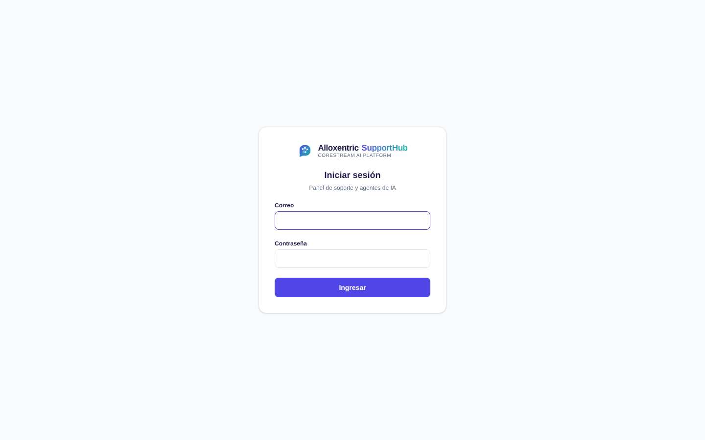

## 0. Usuarios y roles (superadmin y admin de empresa)

En **Usuarios y roles** ves a los usuarios (el admin de empresa, solo los de su empresa). Para crear uno: correo, nombre, contraseña de
al menos 8 caracteres, rol (y empresa, si eres superadmin) y **+ Crear usuario**. En la tabla puedes cambiar el rol, **Desactivar**
(el usuario pierde el acceso al instante) o **Eliminar**. No puedes desactivarte ni cambiarte el rol a ti mismo.

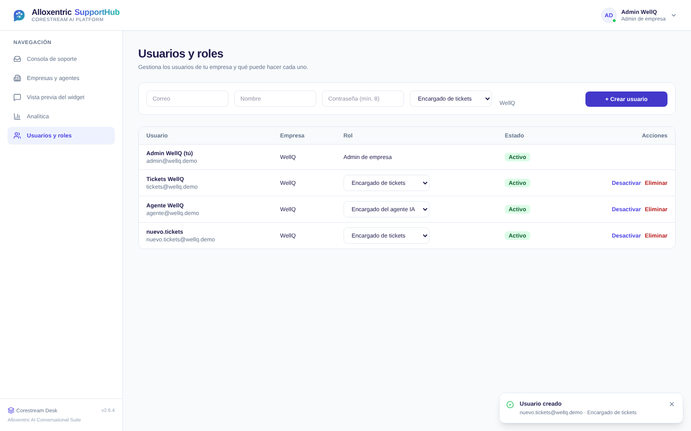

Vista de un **encargado de tickets** (solo consola y analítica, solo los tickets de su empresa):

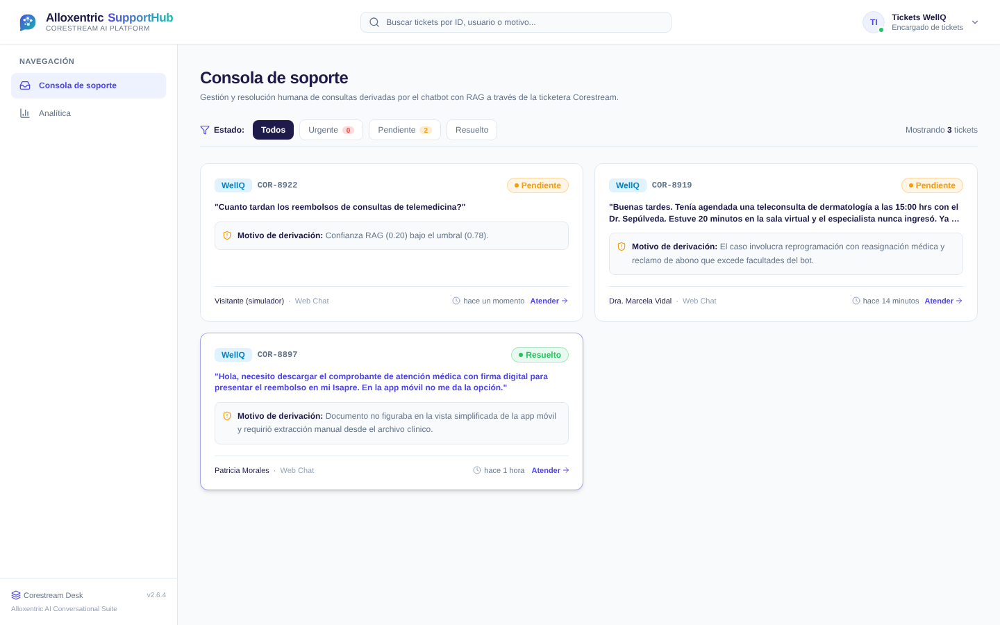

Vista de un **encargado del agente IA** (empresas y agentes, sin consola ni usuarios, sin "Agregar empresa"):

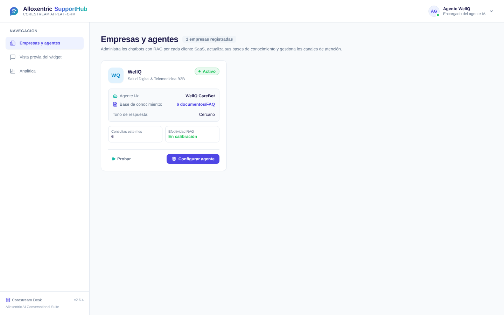

---

## 1. Encargado de tickets — Consola de soporte

### Ver los casos derivados

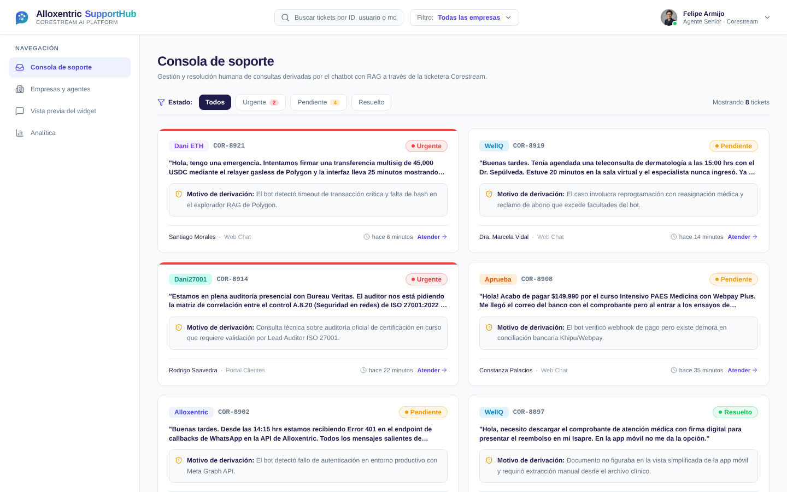

Cada tarjeta es un caso que el bot derivó: empresa, número de ticket (`COR-xxxx`), estado, la consulta del cliente, el motivo de la
derivación y el tiempo transcurrido.

- Filtra por estado (**Urgente**, **Pendiente**, **Resuelto**) con los botones de arriba.
- Filtra por empresa con el selector **Filtro** de la barra superior.
- Busca por número de ticket, cliente o texto en el buscador.
- La pantalla se actualiza sola cada 15 segundos.

### Atender un caso

Pulsa **Atender** en la tarjeta.

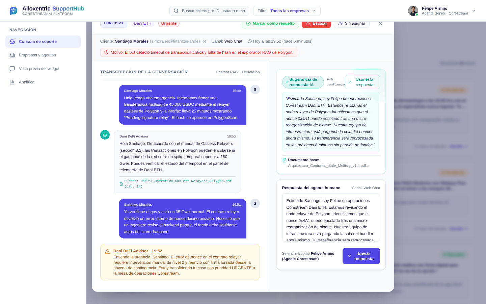

1. A la izquierda lees la **transcripción completa** de la conversación con el bot, incluidas las fuentes que usó.
2. A la derecha hay una **sugerencia de respuesta** con su nivel de confianza y el documento base.
   Con **Usar esta respuesta** la copias al cuadro de respuesta.
3. Edita el texto si hace falta y pulsa **Enviar respuesta**: el mensaje queda en la transcripción y el ticket pasa a **Resuelto**.
4. Otras acciones de la parte superior: **Marcar como resuelto** (sin escribir respuesta), **Escalar** (sube el caso a Urgente)
   y el botón de agente para **reasignar** el caso a otra persona.

> La sugerencia de respuesta es un borrador provisorio; cuando el motor RAG real esté integrado la generará DeepSeek.

---

## 2. Encargado del agente IA y admin — Empresas y agentes

### Ver las empresas

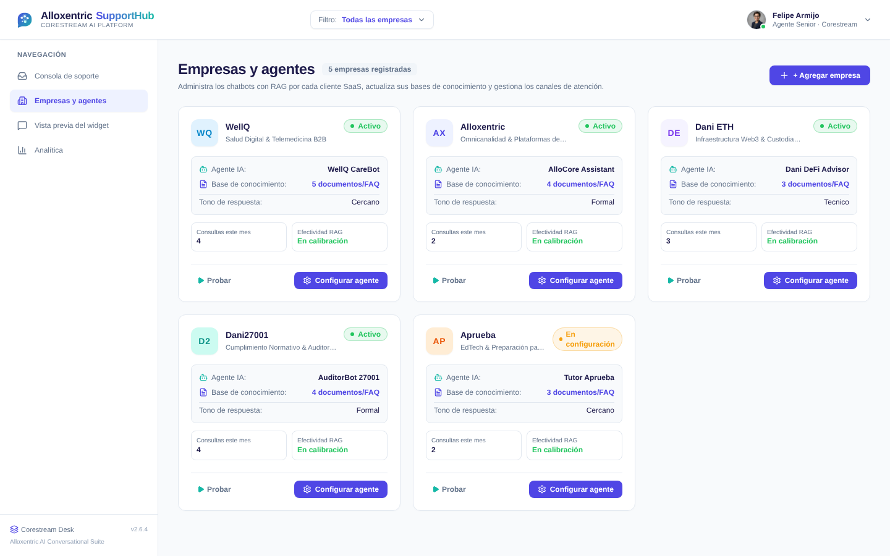

Cada tarjeta muestra la empresa, el estado de su agente (**activo**, **en configuración** o **inactivo**), su tono, los documentos
cargados y sus métricas del último mes. Desde ahí puedes **Probar** el bot o **Configurar agente**.

### Agregar una empresa

Pulsa **+ Agregar empresa**.

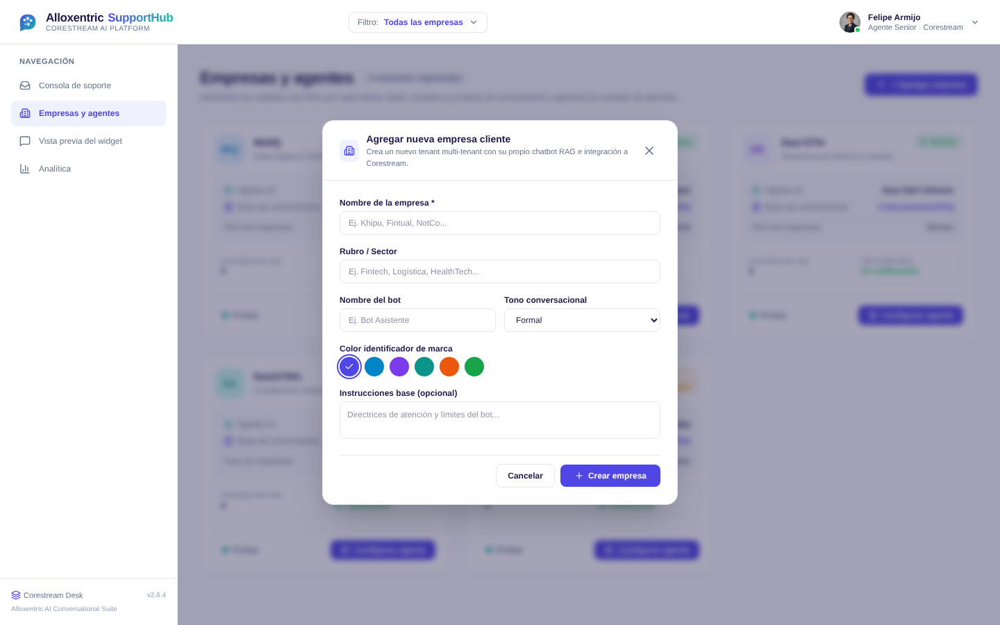

Completa el nombre (obligatorio), el rubro, el nombre del agente, el tono de respuesta, las instrucciones y un color de marca, y
pulsa **Crear empresa**. Queda en estado *en configuración* y sin documentos.

### Configurar el agente y cargar documentos

Pulsa **Configurar agente** en la tarjeta de la empresa.

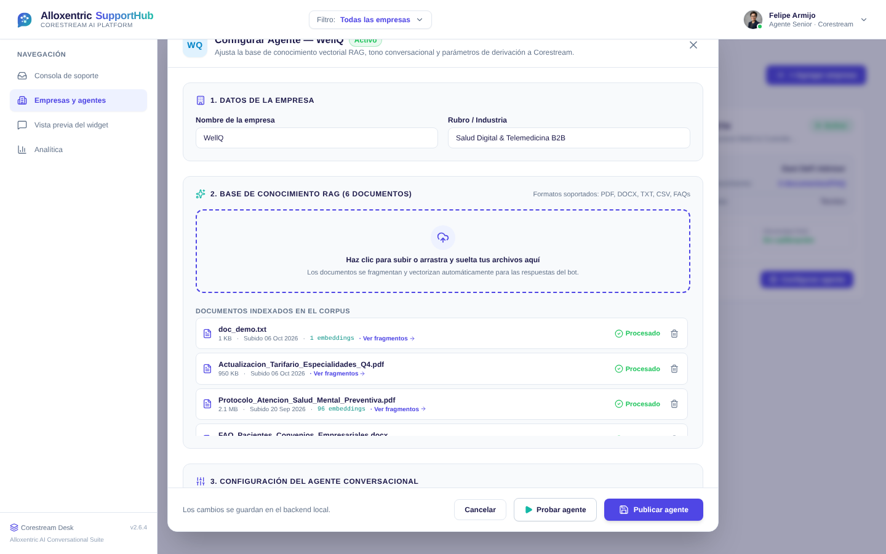

El modal tiene tres secciones, de arriba hacia abajo:

1. **Datos de la empresa:** nombre y rubro.
2. **Base de conocimiento:** haz clic en la zona de carga o arrastra tus archivos (PDF, DOCX, TXT, CSV o FAQ; máximo 20 MB cada uno).
   Cada documento aparece como *procesando* y pasa a *procesado* cuando ya fue dividido en fragmentos.
   Si queda en *error*, el archivo está dañado o no se pudo leer: bórralo y súbelo de nuevo.
   Para quitar un documento, usa el ícono de papelera de su fila.
3. **Configuración del agente conversacional** (bajando en el modal): nombre del agente, tono, instrucciones personalizadas y
   **umbral RAG**. El umbral es la confianza mínima para que el bot responda; mientras más alto, más seguido deriva a un humano.
   Aquí también están el enlace de chat y el acceso al widget embebible (sección siguiente).

Al final, **Publicar agente** guarda los cambios y deja el agente **activo**; **Cancelar** cierra sin guardar. Los documentos, en
cambio, se suben y se borran al instante, sin esperar a publicar.

### Ver los fragmentos de un documento

Haz clic en un documento de la lista.

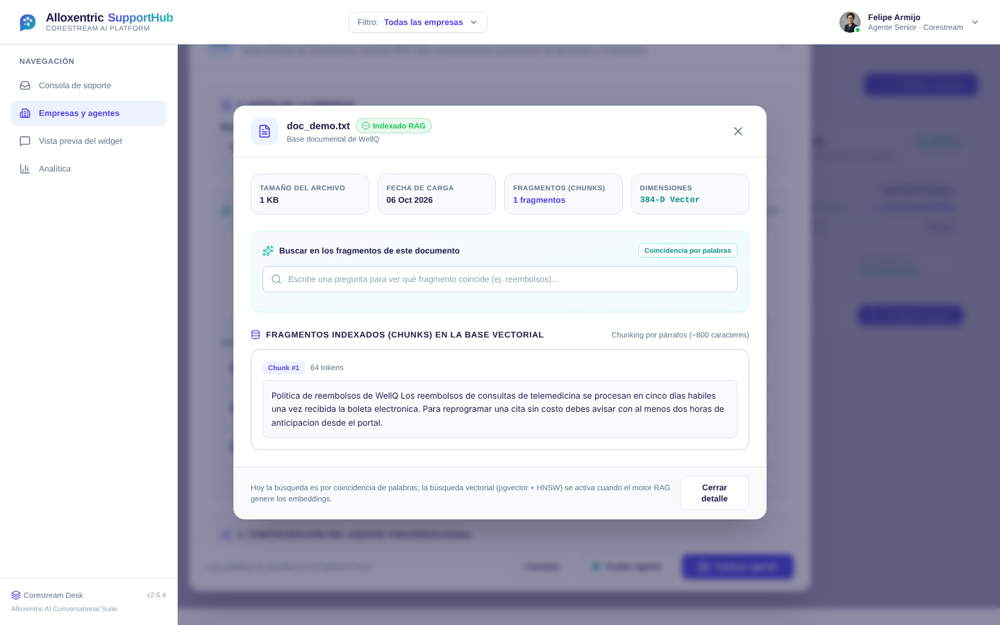

Verás el tamaño, la fecha, el número de fragmentos y el texto de cada uno. El buscador resalta los fragmentos que contienen las
palabras de tu consulta, útil para comprobar que el documento se leyó bien.

### API key y widget embebible

Dentro de **Configurar agente**, pulsa **Ver código del widget embebible**.

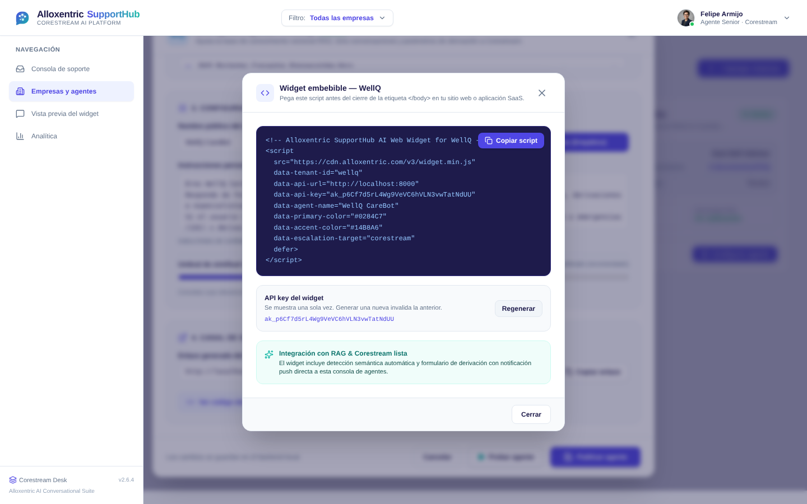

Pulsa **Generar API key**: se muestra **una sola vez**; cópiala. Si la pierdes o la expones, usa **Regenerar** (la anterior deja
de funcionar). El script se copia con **Copiar script**.

> El script `widget.min.js` todavía no está implementado (requisito RF-29). Mientras tanto, la forma de ver el chat es la
> **Vista previa del widget**.

---

## 3. Usuario final — Chat

Se muestra en **Vista previa del widget**, que simula el sitio de la empresa con el chat abierto. Elige la empresa con los botones de
arriba; el ícono de flecha circular reinicia la conversación.

### Hacer una consulta

Escribe en la barra inferior y pulsa Enter. Si la respuesta salió de la documentación, el bot muestra el **documento fuente** y su
**porcentaje de confianza**.

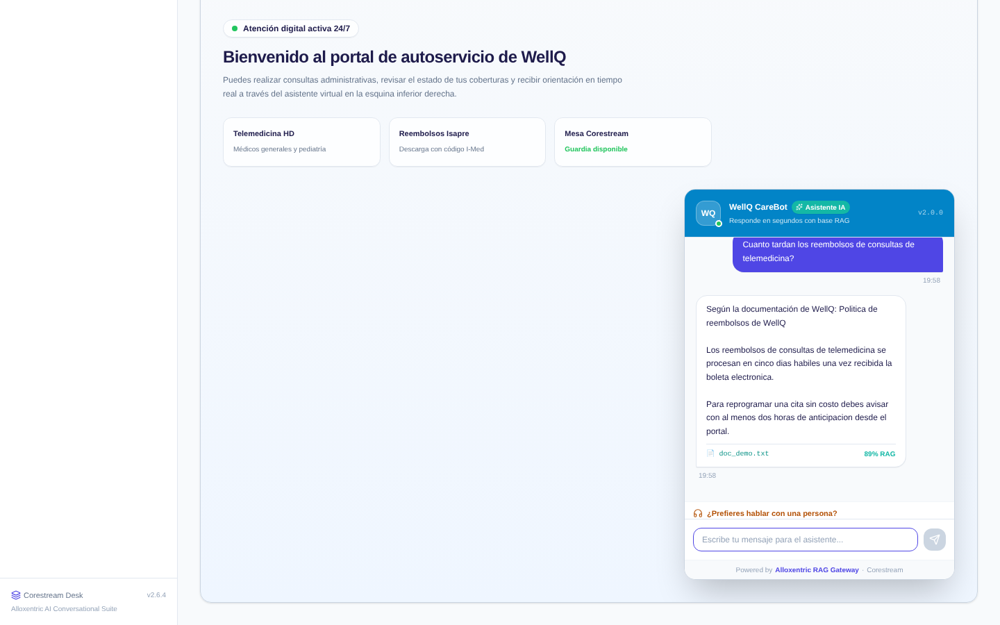

### Cuando el bot no puede ayudar

Si no encuentra información suficiente, o si el usuario lo pide con **¿Prefieres hablar con una persona?**, el bot avisa que
deriva el caso y se crea un ticket automáticamente.

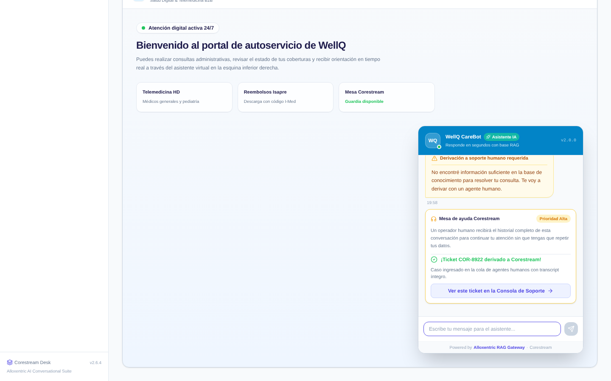

El botón **Ver este ticket en la Consola de Soporte** lleva a la consola de los agentes, donde el caso ya aparece.

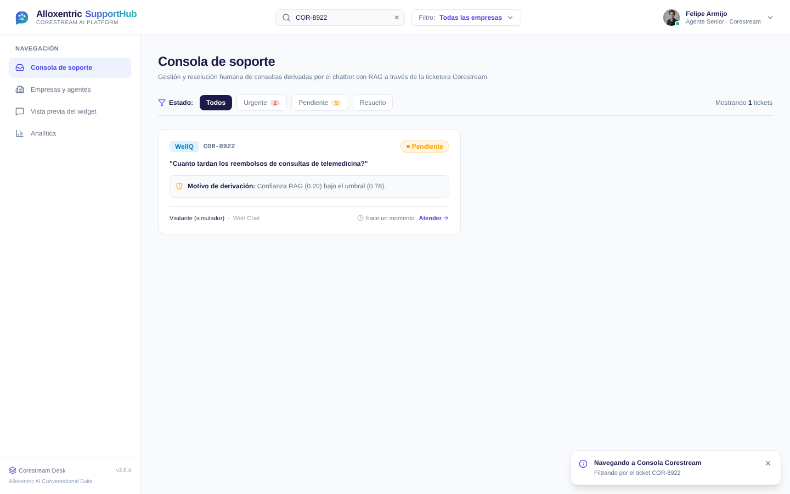

Desde ese momento el bot no vuelve a responder en esa conversación: la atiende el agente humano.

---

## 4. Probar un agente sin salir del panel

En la tarjeta de una empresa, pulsa **Probar** (o **Probar agente** dentro de la configuración) para abrir un simulador de chat.
Usa el mismo motor que el chat real, así que sirve para revisar las respuestas después de cargar documentos.

> Las conversaciones del simulador y de la vista previa son reales: si el bot deriva, se crea un ticket de verdad en la consola.

## 5. Problemas frecuentes

| Síntoma | Causa probable | Qué hacer |
|---|---|---|
| "Credenciales inválidas" al entrar | Correo o clave mal escritos, o el usuario fue desactivado | Revisar los datos o pedir a tu admin que te reactive |
| De repente vuelve al login | La sesión venció (8 h) o desactivaron tu usuario | Volver a iniciar sesión |
| "Tu rol no tiene permiso para esta acción" | La acción no corresponde a tu rol | Pedir a tu admin de empresa que te cambie el rol |
| Aviso rojo "No se pudo cargar la información del backend" | El servidor no está corriendo | Iniciar `uvicorn app.main:app --reload` y pulsar **Reintentar** |
| El bot deriva casi todas las consultas | La empresa no tiene documentos, o el umbral RAG es muy alto | Cargar documentos; bajar el umbral en **Configurar agente** |
| Documento en estado "error" | Archivo corrupto o formato no soportado | Borrarlo y subir otro archivo (PDF, DOCX, TXT, CSV, FAQ) |
| "Tipo no soportado" al subir | Extensión distinta a las permitidas | Convertir el archivo |
| Perdí la API key | Solo se muestra una vez | Usar **Regenerar** en el widget embebible |
| Los documentos de ejemplo no muestran fragmentos | Vienen del seed, sin archivo real | Subir un archivo propio |
| La tasa de resolución del bot aparece en 0 % | Aún no hay conversaciones resueltas por el bot hoy | Conversar con el bot sobre un tema que esté en los documentos |
